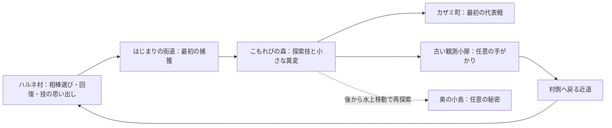

# 最初の地域のマップ・モンスター・代表戦 v0.3

## 位置づけ

採用した「穏やかな旅立ち→相棒選び→初戦と捕獲→森の異変」を、遊べる地域へ落とし込む案。
最初の大きな攻略目標は、森の小さな異変の後に挑むカザミ町の代表戦で確定した。
地名は作業名。一般種の仮名・造形、具体的なマップ配置、代表の編成・レベル帯、イベントの台詞は提案。
この文書は設計資料であり、タイルマップやゲーム素材、本体を実装済みという意味ではない。

## 地域の構成案

村・街道・森・町を主経路にする。観測小屋と近道は寄り道で、初回訪問時に小屋を見なくても本編を理解できる。
奥の小島には未回収表示や地図メモを置き、後から戻る動機を作る。島の重要な報酬は取り返しがつくものにする。
初回で全12属性を一度に教えず、基本の相性と交代・捕獲・探索技を少しずつ体験する。

## マップごとの体験案

| 場所 | 主な内容 | 後から戻る理由 |
|---|---|---|
| ハルネ村 | 家、広場、育成研究所、回復と技の思い出し。3体の仕草を見て相棒を選ぶ | 仲間や設備の増加、会話の変化 |
| はじまりの街道 | 草むら、捕獲講習、短い分岐、初めてのトレーナー戦 | 草むらの昼夜差、取り残した小道 |
| こもれびの森 | つたの支点、古い風見、昼間に落ち着かない夜行性の個体 | 水上移動で小島、後の特殊進化の手がかり |
| 古い観測小屋 | 昔の観測記録の一部、動かせる仕掛け、村へ戻る近道 | 記録の続き、クリア後に意味が分かる補足 |
| カザミ町 | 回復、店、預かり、代表の試験、次の地域への道 | 再戦や依頼の追加を検討 |

タイル座標、建物の内装、衝突判定、エンカウント領域、戦闘画面は実装時に別データとして作る。
現代に近い文明は研究所や連絡設備などで示し、自然中心の最初の地域でも世界全体の文明設定を変えない。

## 最初の地域で扱う12種分のデータ

御三家の初期3種・中間3種と、一般種6種の計12種を初期試作の範囲とする案。
御三家を6種データに持つのは、3通りの開始とレベル16の進化を試すため。本編中に他の御三家を配る意味ではない。
御三家の最終3種は採用済みの造形を引き継ぎ、本編全体の制作で追加する。最初の地域でレベル36まで育てる前提にはしない。

| 安定IDの案 | 仮名 | 属性案 | 見た目と役割の案 | 主な入手場所 |
|---|---|---|---|---|
| wild_seed_squirrel_01 | リスコロ | 無 | 木の実を運ぶ巻き尾のリス。序盤の扱いやすい攻撃役 | 街道 |
| wild_vine_mole_01 | ツルモグ | 草 | 葉の前髪と、短いつたの尾を持つモグラ。探索技を学ぶ | 街道の林際、森の入口 |
| wild_breeze_bird_01 | ハネリ | 風 | 風を受ける扇状の尾を持つ小鳥。速さと交代の練習 | 街道、森の外周 |
| wild_stream_otter_01 | ミズッタ | 水 | 平たい尾で浅瀬をたたくカワウソ。水の攻撃役 | 街道の徒歩で行ける川岸 |
| wild_coil_dormouse_01 | ココイル | 雷 | 巻いた尾で静電気をためるヤマネ。風への対策 | 森の外周、町の近く |
| wild_dusk_glider_01 | ヨルミル | 闇 | 目の周りの模様と薄い飛膜が特徴の夜行性モモンガ | 森。昼の異変イベント、通常はゲーム内の夜 |

一般種6種の造形方向は[比較画像](wild_monsters_concepts_v0.1.png)で採用済み。[デザインの説明](14_early_wild_creatures_v0.2.md)を参照。
表示名・属性・技などは作業案。採用原画を維持し、ゲーム用のドット素材として仕上げる。
御三家の初期3種と中間3種の名前は、既に決めた進化系列を使用する。
一般種の進化系列は本編全体で別に設計し、試作の12種という数に合わせて進化なしの種族へ固定しない。
川岸の水種を捕まえるために水上移動を先に要求する、といった循環条件を作らない。

## 探索技の導入：つたうちの案

森の小さな崖に、つたを掛けられる支点を置く。
講習で「つたうち」を習得できるようにし、手持ちの4技の1枠へ入れて初めて使える。
ツルモグを森に入る前から入手可能にし、草の御三家を選ばなくても進める。
ツルモグは希少出現にしない。必須の習得手段は再利用可能にする。
道具や所持金を使い切った初心者にも、捕獲講習で基本道具を再補充するなどの救済を用意する案。
救済は売却による無限の資金源にならないよう別途定義し、捕獲自体の基本方式は確率方式を維持する。
開いた足場と帰路を保存し、途中で技を入れ替えても村まで戻れるようにする。

## 森の異変イベント案

昼間なのにヨルミルの群れが眠らず、同じ場所を何度も行き来している。
近くの新しい育成記録設備は正常表示だが、古い風見の動きと、群れが落ち着かなくなるタイミングが合っていない。
幼なじみは記録を確かめようとし、主人公は足跡・木陰・風見を観察する。まだ激しい対立にはしない。
風見の向きと簡単な仕掛けを合わせ、群れを安全な木陰へ導く。
固定個体との戦闘を入れる場合、捕獲成功と撃破のどちらでも依頼が進む案。捕獲を選ぶとイベントが止まる実装にしない。
初回では事件の全容を明かさず、「記録と現地の様子が少し食い違っている」と気づく程度にする。
異変を解消してもヨルミルの収集経路は失わず、通常のゲーム内夜や後の再遭遇で捕獲できる。

## 確定した最初の大きな攻略目標：町の代表戦

森の異変を小さく解決した後、カザミ町で代表へ挑む構成をユーザーが採用した。
代表戦を次の地域へ回し、森の野生の強敵を最初の大きな目標にする別案は採用しない。
旅の主目的である大会へ向けた最初の達成を作り、事件だけで旅の動機を置き換えない。
代表の専門は属性一つではなく「相棒の様子を見て、交代を使うこと」とする案。

- 1対1の通常ルール、相手の手持ちは3体。
- 編成の初期案：リスコロLv13、ハネリLv14、ヨルミルLv15。技と持ち物は別途設計する。
- プレイヤーの相棒はLv14～16程度を想定し、周囲の冒険で自然に届く経験値配分を目指す。戦闘結果は未検証。
- 草の相棒に対する風の相手には、街道・森で仲間にした雷の個体などで対応できる。相棒を何度も選び直す必要を作らない。
- 予告されていない能力値の底上げや、プレイヤーだけが受ける隠れた不利補正を使わない。
- 敗北しても通常の全滅ルールで復帰し、何度でも再挑戦できる。
- 代表戦の前後にレベル16の進化を体験する2～4時間程度の地域を目標にする。時間は未検証で、進化条件そのものはレベル16。

代表の手持ち3体・レベル13～15の編成は初期案。御三家3通りの実際の進行で難易度を確認し、調整する。
[Claude Codeへの試作指示](15_claude_first_region_prompt_v0.2.md)で、実装の順序と完了条件を具体化した。

## 試作の区切りと確認項目

実装・プレイ確認は未実施。以下を試作で実行する。

1. 御三家の3通りすべてで、相棒選び→初戦→捕獲→探索技→森のイベント→強敵→レベル16進化→保存と再開を通せる。
2. 必要な一般種と探索技が、それを使う地点より前に入手できる。所持金0・道具不足・捕獲失敗から立て直せる。
3. 初戦に負ける、任意の小屋を無視する、固定個体を捕まえる、会話を省略する場合にも進む。
4. 近道の開通、図鑑登録、技の習得、進化、強敵の報酬が、中断後に消えたり重複したりしない。
5. クリア前に他の御三家は受け取れない。小島の秘密は後から回収でき、初回で全部を解くことを要求しない。
6. 技枠、タッチ操作、読みやすさ、相性表示、読み込み、オフライン保存の実際の使い心地を確認する。

変更履歴：v0.1 最初の地域の地図構成、一般種6種、イベント、代表戦の案を具体化。

変更履歴：v0.2 ユーザーの「2.A」を反映し、最初の大きな目標を町の代表戦に確定。一般種の画像と試作指示を追加。

変更履歴：v0.3 一般種6種の造形方向の採用を反映。試作指示と最新デザイン説明へ接続。
