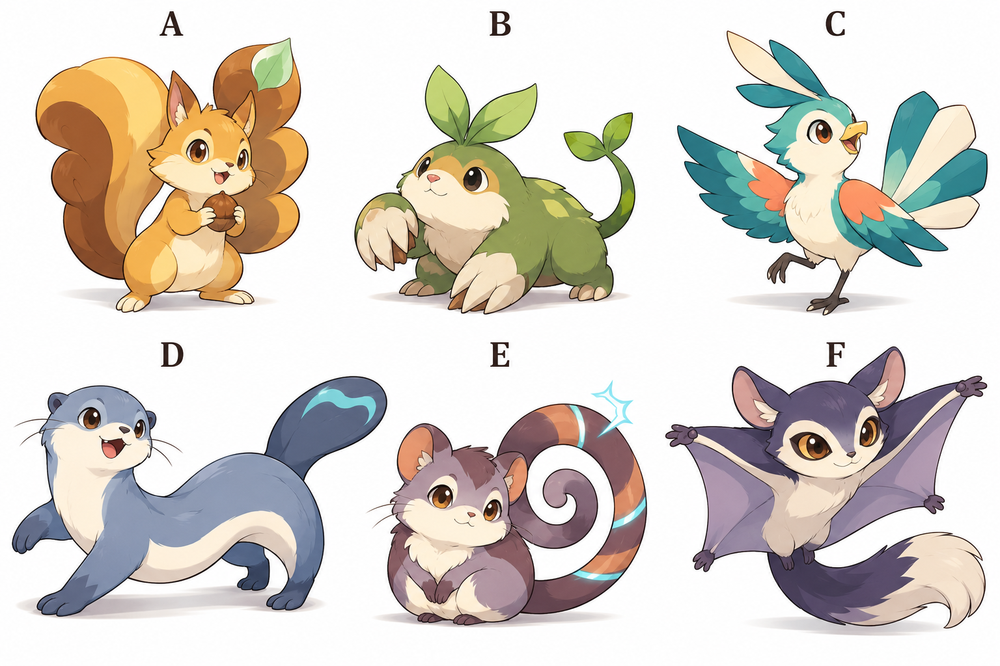

# 序盤の一般モンスター6種：採用したデザイン v0.2

## 比較画像

ユーザーの「A」を受け、A～Fの6種すべての造形方向を採用した。
内蔵画像生成で制作した比較ボードを基準原画として維持し、設定画・ドット絵・アイコンへ展開する。ゲーム用スプライトの仕上げはこれから。
採用済みの御三家の原画は変更していない。6種の表示名と属性は、現時点では作業用の案。

| 位置 | 作業名・属性案 | モチーフと識別点 | 序盤の役割 |
|---|---|---|---|
| 上段左 A | リスコロ・無 | 木の実と、種房のようにふくらむ大きな尾。活発なリス | 扱いやすい攻撃役 |
| 上段中央 B | ツルモグ・草 | 葉の前髪、つたの尾、低い体と大きな前足のモグラ | 探索技の導入。草の相棒以外でも森を進める |
| 上段右 C | ハネリ・風 | 青緑と珊瑚色の羽、扇状の尾。軽快な小鳥 | 速さと交代の練習 |
| 下段左 D | ミズッタ・水 | 細長い体、平たい尾と水紋。活動的なカワウソ | 序盤の水の攻撃役 |
| 下段中央 E | ココイル・雷 | 薄紫と茶の体、大きく巻く尾と発光する帯。ヤマネ | 風属性への対策 |
| 下段右 F | ヨルミル・闇 | 藍色と紫の飛膜、目の周りの模様。夜行性モモンガ | 森の異変、ゲーム内昼夜の遭遇 |

## デザインの狙い

同じ世界の仲間に見える線・塗り・親しみやすさをそろえ、立ち姿、輪郭、顔、尾の形、配色で区別する。
無属性のAも集めたくなる魅力を持たせる。闇属性のFも、怖さや悪役らしさへ固定しない。
水のDは、御三家の水の熊と違う横長の体と尾を特徴にする。
雷のEは淡い紫と茶の配色にし、尾の巻き形と帯を発電の表現にする。

## 採用した造形を素材へ仕上げる作業

- Aの尾の付け根と分かれ方、Fの飛膜の接続、各種の前後左右を設定画で統一する。
- 生成画像の小さな手足や器官をそのまま仕様へ固定せず、歩行・攻撃で矛盾しない構造へ整える。
- 小さな表示で見分けられる配色と形へ整理してから、ドット絵、背面、アイコンを作る。
- 6種の進化先・成長曲線・詳細な技は本編全体に合わせて設計する。
- この6種の造形方向は採用済み。御三家の中間形は引き続き提案として区別する。素材の仕上げを待つ間は、仮表示で保存・移動・戦闘の仕組みを検証できる。仮表示を完成した美術として報告しない。

## 生成記録

方式：内蔵の画像生成ツール。従量APIや外部の有料画像生成サービスは使用していない。
新規の比較ボードとして生成。既存キャラクター画像の参照入力は使用していない。
[実際に渡した生成指示](wild_monsters_prompt_v0.1.txt)を保存した。

変更履歴：v0.1 序盤の一般種6種を比較画像として制作。採用状況は確認中。

変更履歴：v0.2 ユーザーの「A」により6種の造形方向を採用。名前・属性・技・進化先の詳細は設計案として維持。
