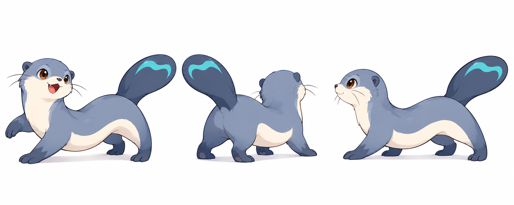
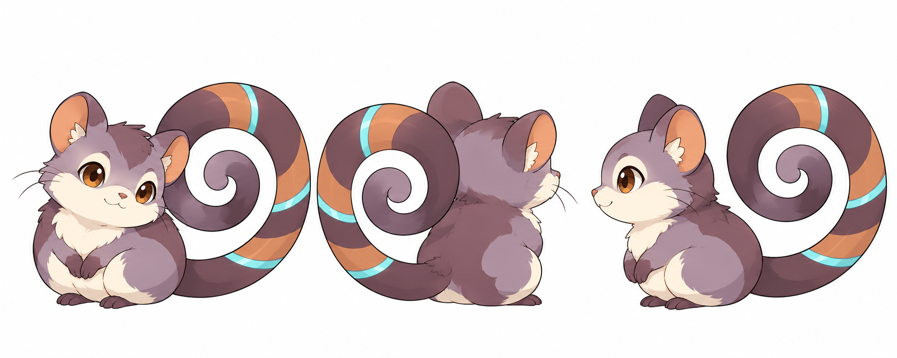
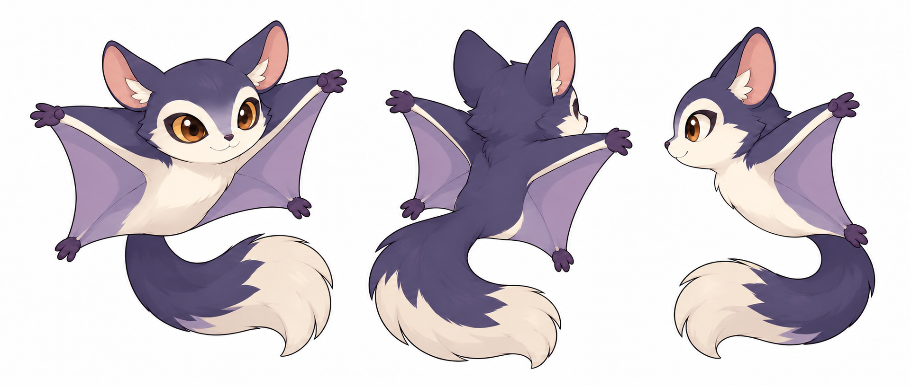

# ミズッタ・ココイル・ヨルミル：前後横の新設定画案

2026-11-02。リスコロ・ツルモグ・ハネリのドットPNG9枚を、ユーザーが「3体ともこのまま採用」と回答。続いて、採用済みの6体比較原画の下段3体を前後横へ展開した。

**元の造形方向は採用済み。今回補った背面・横面・接続は新しい案で、ユーザー確認待ち。** 名前・属性は作業案のまま。進化先・能力値やドット素材の採用を意味しない。

画像は左から、斜め前・右上を向く斜め後ろ・左向きの横面。全身と尾を白地に並べ、既存の設定画と線・塗りをそろえた。戦闘前面の左下向きへの調整は、採用後の個別素材書き出し時に行う。

## ミズッタ v0.1

長く低い胴、灰青と象牙色の体、丸い耳とひげ、短い四肢、1本の平たい尾を維持。尾の上面側に水色の水紋を置いた。水の相棒の熊と違う横長のシルエットを残した。

確認点：胴の長さ、後脚から尾へのつながり、背面と横面でも平たい尾として自然に見えるか。

## ココイル v0.1

薄紫とプラム茶、象牙色の顔・腹、銅色の耳内側、低く座る姿を維持。腰からつながる1本の尾を、白い隙間のある大きな渦にした。銅色3帯と水色3帯は尾の同じ区間に巻き、体へ増やしていない。浮く放電エフェクトは構造の確認を優先して省いた。

確認点：尾の付け根と巻き方、帯の前後・横での連続性、原画と同じ顔と体格に見えるか。

## ヨルミル v0.2（今回の確認対象）

藍色の背、紫の飛膜、象牙色の頬・腹・尾先、大きな茶色の目を維持。**前脚2本・後脚2本の四肢**で、左右の飛膜はそれぞれ前脚の手首から後脚の足首へつながる。独立した翼や腹下の追加脚はない。横面では奥の四肢が重なる。

初回のv0.1は飛膜端の後脚とは別に腹下へ小さな脚が描かれ、6肢に見えたため不採用。内蔵画像生成でその部分を修正したv0.2だけを今回の確認対象にした。旧案はsourceと台帳に不採用として残し、原画や他の採用済み素材を上書きしていない。

確認点：4つの膜端がそれぞれ前脚・後脚であること、腰から後脚への膜の張り方、1本の尾と膜が混ざらず読めるか。

## 実ファイルと制作記録

| 画像 | 実寸 | 状態 |
|---|---|---|
| ミズッタ v0.1 | RGB PNG・1983×793 | 新設定画・確認待ち |
| ココイル v0.1 | RGB PNG・1983×793 | 新設定画・確認待ち |
| ヨルミル v0.2 | RGB PNG・1922×818 | 四肢へ修正・確認待ち |
| ヨルミル v0.1 | RGB PNG・1923×818 | 旧6肢案・不採用 |

高解像度の参照資料であり、透過済み96pxスプライトではない。今回の生成は内蔵画像生成を使用し、別料金の外部APIは使用していない。比較原画と既存リスコロ設定画を参照し、生成指示はdocs/prompts/のmizutta・cocoil・yorumiruのmodel_sheetファイルとanatomy_fixへ保存した。

台帳49件。runtime PNGは19枚のままで、すべて採用済み（御三家9＋一般種9＋UI枠1）。全図鑑・人物・地形・音源は未完成。新設定画の採用回答後、前後96px・アイコン32pxへ展開する。
