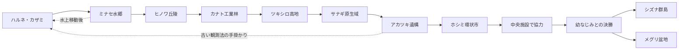

# 全体の骨格案 v0.1

2026-11-02・日本時間。**ユーザー回答：156種・本編8地域／代表8人・クリア後2地域で骨格案を進める。対立側は比較案B「一部責任者の隠蔽」を採用。** 個々の地名、人物の具体像、章、系統配分、技・数値は以下の提案。Bの展開は[物語の具体化](STORY_CONFLICT_B_v0.1.md)を参照。

## 旅の軸

幼なじみとの「二人で決勝に立つ」約束を道しるべに、暮らしの違う8地域を巡る。各地で育成補助技術の記録と実際の生態が少しずつ食い違う。主人公は寄り道で見つけた観察を持ち帰り、勝利を急ぐ幼なじみとぶつかり、協力して大会へ戻る。

大会を事件の添え物にしない。8代表は単一属性の関門ではなく、旅で覚えた「観察・交代・育成」を別の方法で試す人々にする。大きな死や永続的な別れを解決の代償にしない。

## 地域・章・人物・制作素材の対応

人物名と地名は作業名。地図順は固定、点線の再訪を増やす。新規種数は進化形込みで、他地域で再登場する種を二重加算しない。

| 順・章案 | 地域と代表案 | 体験・異変・ライバル | 主な美術セット | 新規種枠 |
|---|---|---|---|---:|
| 序章＋第1章 | ハルネ村～カザミ町／サヨ・配達員 | 穏やかな旅立ち→捕獲→こもれびの森→最初の代表戦。夜行種の活動がずれる。相棒を観察し交代する試験 | 草地、果樹、赤瓦の村、研究所、木橋、森、観測小屋 | 12 |
| 第2章 | ミナセ水郷／ナギ・水路管理人 | 水門へ群れが偏る。分流の順序を調べる。幼なじみは記録どおりの最短手順を試す。水上移動の取得候補 | 水路、石橋、湿地、葦、港、船着場 | 18 |
| 第3章 | ヒノワ丘陵／エン・窯工房の職人 | 窯と地熱帯で温度記録が食い違う。状態変化と交代。失敗した幼なじみが練習量を増やす | 黄土の丘、窯、温泉、地熱洞、灯火 | 18 |
| 第4章 | カナト工業林／リツ・整備士 | 木々と工場の境目で信号が重なる。最初の2対2講習。幼なじみの固定した勝ち筋を崩し衝突が始まる | 鋼の歩道、温室、発電施設、緑化された駅 | 18 |
| 第5章 | ツキシロ高地／シオン・観測員 | 雪と夜空の活動周期を調べる。寄り道の知識が正規記録を補う。二人はいったん別行動 | 雪、氷、針葉樹、稜線、天文台 | 18 |
| 第6章 | サナギ原生域／スイ・保全員 | 毒を持つ種も生態系を支える。単なる汚染退治にしない。幼なじみが相棒に合う育て方を探し直す | 巨木、菌床、沼、保全小屋、根の洞窟 | 18 |
| 第7章 | アカツキ遺構／トワ・史料修復師 | 古い観測法が地域差を残していたと知る。序盤の風見と標識を回収し、幼なじみと協力へ | 白石、崩れた階段、反射鏡、地下の水路 | 15 |
| 第8章 | ホシミ環状市／ヒビキ・大会運営の実戦指導員 | 最後の代表戦で編成の総仕上げ。同期運用の中心へ進む準備。大会は中止にして終わらせない | 現代的な市街、路面交通、管理施設、観測塔 | 12 |
| 第9章 | 各地への再訪＋中央観測施設 | 記録の隠蔽を明らかにし、責任者と対決。社内協力者・幼なじみと安全な運用へ調整する | 既存の施設を再利用＋中枢機器・変化差分 | 0 |
| 第10章 | 大会本戦・決勝 | 幼なじみと約束の決勝へ。互いの旅の選択を認め、本編の疑問を回収。主人公の敗北は再挑戦へ | 観客席、控室、決勝フィールド、表彰 | 0 |
| 後日章A | シズナ群島 | 他の御三家の保護イベント、希少種、海の再探索。固定希少種にも再挑戦経路 | 海岸、潮だまり、海蝕洞、保護施設 | 9 |
| 後日章B | メグリ盆地 | 繁殖・技継承・理想個体へ近づける施設、秘密の進化、代表再戦 | 育成牧場、花畑、地下湖、古い観測環 | 9 |

別枠で御三家3系列9種を確保する。合計 **9＋12＋18×5＋15＋12＋9＋9＝156種**。最初の選択で得るのは1系列。他の2系列はクリア後のイベントで入手する。

種枠は制作の予算配分であり、156種の名前・能力・全系統が完成した意味ではない。新規一般種の絵の量産は、系統表をレビューしてから地域単位で行う。

## モンスター系統の出発点

| 系統 | 既存の起点 | 次の形の提案 | 設計上の変化 |
|---|---|---|---|
| 草の相棒 | ハナミミ→ハナリット→フロレーヌ | 既存の3段階を維持 | つぼみ→開花途中→3房の花弁の流れ。中間形の造形は未採用 |
| 炎の相棒 | ホノル→フレイガ→グレンヴァル | 既存の3段階を維持 | 幼い翼→自力で支える翼→大きな炎翼。ユーザー指定の独立腕2・脚2・翼2で接続を統一 |
| 水の相棒 | ミオマル→ナミグマ→タイドガル | 既存の3段階を維持 | 小さな波形→小型の盾→重い前腕と波の盾 |
| 木の実リス | リスコロ | コノミリア（無・草案） | 抱えていた木の実を尾の種房に蓄える。単なる大型化を避ける |
| つたモグラ | ツルモグ | ネヅナグ（草・地案） | 掘る前足と支点を結ぶつた。必須技の習得を進化後だけにしない |
| 扇尾の小鳥 | ハネリ | オウギル（風案） | 尾羽が一枚の大きな扇の輪郭へ。先手・交代の役割 |
| 川のカワウソ | ミズッタ | カワミオ（水案） | 平たい尾と長い胴で流れを切る。水の相棒と体格を分ける |
| コイル尾のヤマネ | ココイル | マキデン（雷案） | 巻いた尾の帯を増やし蓄電器官を明確化。黄色一色に変えない |
| 夜のモモンガ | ヨルミル | ヨイトバリ（闇・風案） | 目周りの模様と飛膜を引き継ぎ、静かな翼膜の広がりを見せる |

一般種6系列を2段階にする案で12枠。追加6体は名前・属性・造形とも提案。進化レベルは未設定。既存6体の造形採用を、新しい進化先の承認に読み替えない。

残り135枠では、地域ごとに「小さくかわいい種」「力強い／華やかな到達形」「生態や謎解きに関わる種」を混ぜる。草地の小動物ばかりに偏らず、水生、虫、鉱物、人工物に共生する種も含める。12属性すべての単独入手と、秘密進化の再取得を系統表で点検する。

## 主要人物案

8代表以外に、幼なじみの作業名を**ユウリ**、村の育成研究者を**ミナモ**、各地の観測記録を運ぶ調査員を**セナ**、技継承を研究する育成家を**カナエ**、旧観測記録の保管者を**イオ**とする。名前・外見・性別の固定は提案段階。ユウリの動機は確定済みの「今度こそ二人で決勝に立ちたい焦り」。

ミナモは相棒選びと研究、セナは地域を結ぶ調査、カナエは育成と後日の盆地、イオは古い観測法を担当する。同じ説明をするNPCを増やすための人物にしない。各代表にも大会以外の仕事と、地域を案内する短い再会を用意する。

## 対立側：B採用、以下は比較の経緯

企業の作業名は「トキワ計測社」、新しい育成補助技術は「ペースリンク」。どちらも名前の案で、ゲーム中のAIサービスや外部通信を要求する意味ではない。

| 比較点 | A：善意の標準化が招く失敗 | B：一部責任者の隠蔽 |
|---|---|---|
| 中心人物 | 研究責任者アサギ。救われた相棒がいたため標準化を信じる | 運用責任者クロセ。大会への正式導入を優先し不具合報告を止める |
| 第4～6章 | 現地を知らず報告を誤分類する。担当者にも迷いが見える | 正常なログと実際の被害が合わず、社内の協力者から欠落記録を得る |
| 第7章 | 旧記録を見せても「まだ証拠が足りない」と衝突 | 書き換え前の観測記録と、隠していた運用指示をそろえる |
| 第9章の対決 | 技術を守りたい責任者との正規ルールの勝負、その後に共同修正 | 運用停止を妨げる責任者との勝負、協力者と安全な調整へ |
| 結末 | 地域担当者の観察を運用へ戻す。便利な育成補助は残る | 隠蔽を明らかにし責任を問う。企業全体や技術を悪者にしない |
| 感触 | 人間関係と価値観の衝突が中心 | 原因を追う謎と、明確な対決の達成感が強い |

ユーザーはBを選択した。Aの研究責任者アサギを追加登場人物として制作しない。Bの責任者クロセ＋社内協力者1人の既存2枠を使い、人物・歩行・表情の見積もりを増やさず具体化する。名前と外見は提案。

## 再訪と取り逃し防止

水上移動は徒歩で行ける場所の通常水種から取得できるよう設計する。探索技は実際に覚えて手持ちに入れ、戦闘の4枠を使う。習得技・忘却・使用回数0・預け入れ後の帰路について、帰還手段や開通状態保存などの具体策は次の仕様相談で詰める。ここでは採用済みとしない。

本編20～30時間、主要な後日要素込み約50時間は引き続き目標。地域を8つ割り当てたことだけで所要時間を検証済みとしない。
