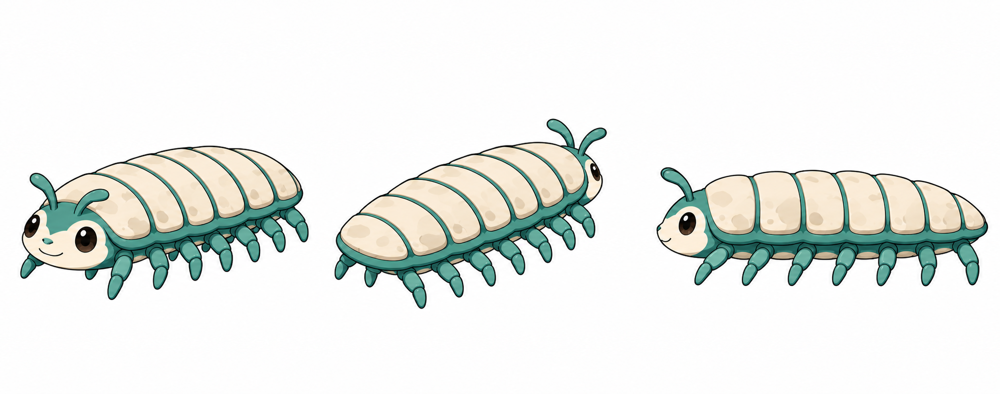
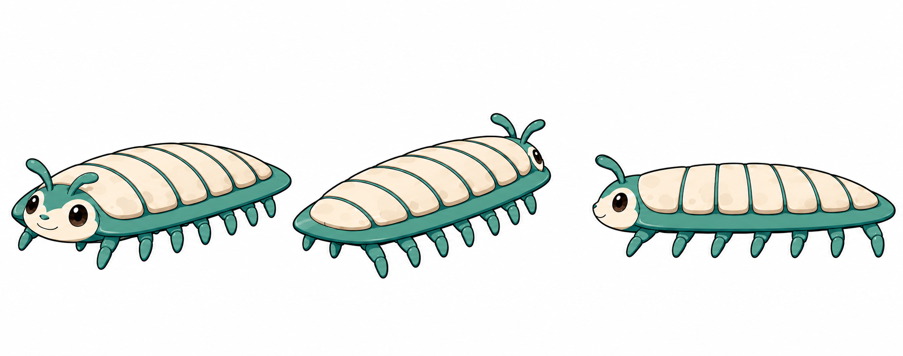
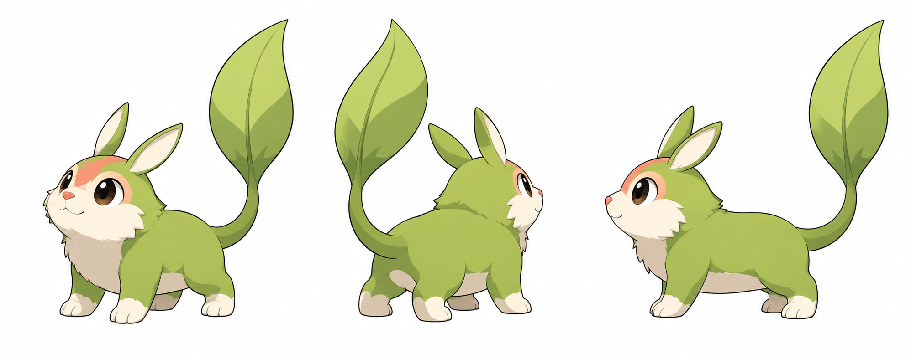
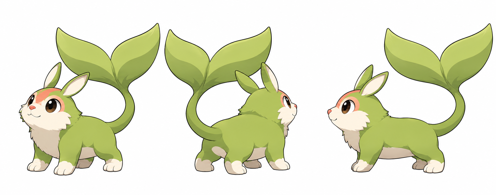
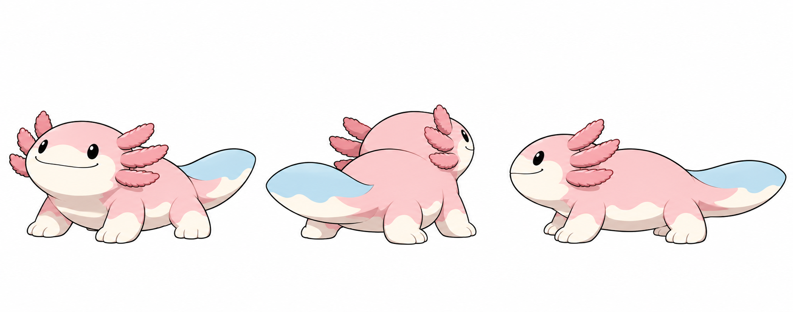
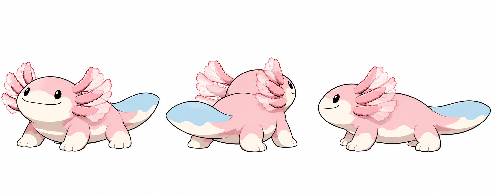
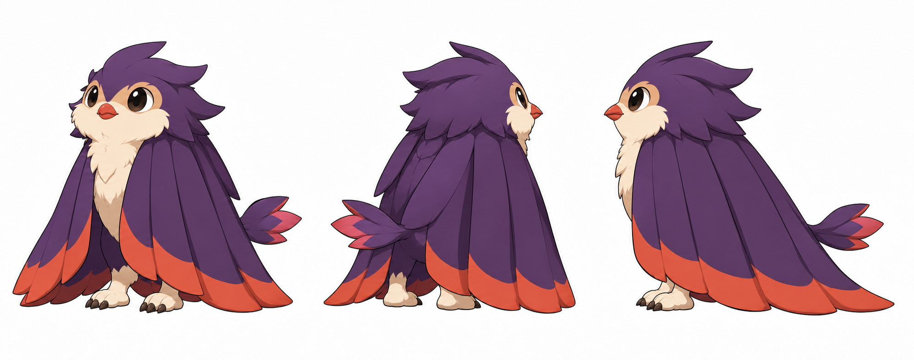

# MONORICA s05 画像レビュー一覧

2026-11-05（日本時間）。担当27種／画像保存確認済み7種／未完了20種。採用状態は全て `pending_user_review`。

137の生成2回と138の生成1回が画像生成側の出力段階で拒否され、画像本体は返されていません。残りの制作を停止しています。

| 図鑑 | 種ID | 名前 | 状態 | 画像本体 |
|---:|---|---|---|---|
| 130 | `wild_metro_isopod_01` | ミチコロ | 保存確認済み | [設定画](https://github.com/chihirohashimotoac-coder/MONORICA/blob/6560402b53d3c710bcf90c30e6eae13918b10c98/assets/source/monsters/parallel_20261104/s05/wild_metro_isopod_01/model_sheet_v0.1.png) |
| 131 | `wild_metro_isopod_02` | イシワタリ | 保存確認済み | [設定画](https://github.com/chihirohashimotoac-coder/MONORICA/blob/eb54b2ab8699b3cd13744aaf2c0347485469798e/assets/source/monsters/parallel_20261104/s05/wild_metro_isopod_02/model_sheet_v0.1.png) |
| 132 | `wild_rooftop_sail_01` | ハタモチ | 保存確認済み | [設定画](https://github.com/chihirohashimotoac-coder/MONORICA/blob/c981e82aa2a1d1a969b5ebafa07f5a6e48b04d03/assets/source/monsters/parallel_20261104/s05/wild_rooftop_sail_01/model_sheet_v0.1.png) |
| 133 | `wild_rooftop_sail_02` | ソラハコビ | 保存確認済み | [設定画](https://github.com/chihirohashimotoac-coder/MONORICA/blob/3d71566eb654729f17e9ce5f2169a44e79895062/assets/source/monsters/parallel_20261104/s05/wild_rooftop_sail_02/model_sheet_v0.1.png) |
| 134 | `wild_fountain_axolotl_01` | ミナプル | 保存確認済み | [設定画](https://github.com/chihirohashimotoac-coder/MONORICA/blob/f4f0277ca4555cfc354a0eb2dddb5a92bc61dbf3/assets/source/monsters/parallel_20261104/s05/wild_fountain_axolotl_01/model_sheet_v0.1.png) |
| 135 | `wild_fountain_axolotl_02` | ニジエルム | 保存確認済み | [設定画](https://github.com/chihirohashimotoac-coder/MONORICA/blob/0848e7452a4a643ae82ae17e71b5729652ea9fe1/assets/source/monsters/parallel_20261104/s05/wild_fountain_axolotl_02/model_sheet_v0.1.png) |
| 136 | `wild_night_curtain_01` | ヨルカーテ | 保存確認済み | [設定画](https://github.com/chihirohashimotoac-coder/MONORICA/blob/d7b50f6327dffe0169465f00c9c935f93d419058/assets/source/monsters/parallel_20261104/s05/wild_night_curtain_01/model_sheet_v0.1.png) |
| 137 | `wild_thermal_fan_01` | ネツハオラ | 未着手 | 未制作 |
| 138 | `wild_rain_garden_01` | アマウツワ | 未着手 | 未制作 |
| 139 | `wild_tide_veil_01` | シオフリ | 未着手 | 未制作 |
| 140 | `wild_tide_veil_02` | ナギヴェル | 未着手 | 未制作 |
| 141 | `wild_tide_veil_03` | シオルミア | 未着手 | 未制作 |
| 142 | `wild_reef_kiln_01` | サンゴロネ | 未着手 | 未制作 |
| 143 | `wild_reef_kiln_02` | ユサンゴル | 未着手 | 未制作 |
| 144 | `wild_shell_harp_01` | カイネリ | 未着手 | 未制作 |
| 145 | `wild_shell_harp_02` | ナギハープ | 未着手 | 未制作 |
| 146 | `wild_brine_orb_01` | シオムクリ | 未着手 | 未制作 |
| 147 | `wild_reef_crown_01` | カンショル | 未着手 | 未制作 |
| 148 | `wild_memory_seed_01` | タネリコ | 未着手 | 未制作 |
| 149 | `wild_memory_seed_02` | メグルコ | 未着手 | 未制作 |
| 150 | `wild_memory_seed_03` | ワノリオン | 未着手 | 未制作 |
| 151 | `wild_frost_lotus_01` | ヒエツボミ | 未着手 | 未制作 |
| 152 | `wild_frost_lotus_02` | ハクリエナ | 未着手 | 未制作 |
| 153 | `wild_hollow_loam_01` | ホロツチ | 未着手 | 未制作 |
| 154 | `wild_hollow_loam_02` | ドウロム | 未着手 | 未制作 |
| 155 | `wild_dusk_compass_01` | ヨイシルベ | 未着手 | 未制作 |
| 156 | `wild_filament_worm_01` | イトツムリ | 未着手 | 未制作 |

## 保存確認済み候補

以下は実際に生成・画像本体保存・GitHub読み戻しを確認した候補です。美術採用やruntime適合の承認ではありません。

### 130 ミチコロ

実測：1995×788、RGB、1538855 bytes。SHA-256：`32c0f14a8413cd4054cbf564430cc473d6284101def5e8b5bf1a7f4156ab7cd1`。

確認：前3/4・後3/4・横の3ビュー、全身と触角が枠内、文字なし。修正後は横の背板7枚と手前脚7本を目視。三面で石灰・青緑の色面と低い外形を維持。

残る確認事項：遠側脚の一部は重なりのため全14本の個別描き分けを目視しにくい。

### 131 イシワタリ

実測：1997×787、RGB、1279261 bytes。SHA-256：`6e50e90c1bb3b036fd1e1aca621e335718aec8e6e441e753f6049bfb37c0ec43`。

確認：3ビュー・全身・白地・文字なし、横ビューの背板7枚と手前脚7本を確認。基礎形と配色・顔を維持し、縁の張り出した低い橋形へ成長。

残る確認事項：斜めビューの後端背節と遠側脚は重なり、全数の個別識別が難しい。

### 132 ハタモチ

実測：1995×788、RGB、1338816 bytes。SHA-256：`5c41be494476238b9a625f73907d44ef882965ea34525658d44595b5c0ca088e`。

確認：前3/4・後3/4・横の三面、全身・葉尾を枠内に確認。四脚、細い耳2つ、尾1本の先端に縦長葉帆1面、四肢への膜接続なし。浅緑・灰白系と珊瑚の差し色を三面で確認。

残る確認事項：今回の目視で明確な設計違反なし。ユーザーの美術確認待ち。

### 133 ソラハコビ

実測：1995×788、RGB、1373726 bytes。SHA-256：`1937197ccf7a7e30c15a006bc0c6b340799e1d8e1728a8e6676f2f8ef621d703`。

確認：三面・全身・文字なし、四脚と耳2つ、尾1本を目視。尾先の帆が横へ広がり基礎形の縦長葉と区別、四肢への膜なし。基礎形の顔・浅緑・灰白・珊瑚色を継承。

残る確認事項：横広帆の中央のくぼみは二葉状に見えるが、尾先1か所への連続膜として表現。

### 134 ミナプル

実測：1995×788、RGB、1220347 bytes。SHA-256：`3918eb618de61a82ad4b02dec895cac4b1adae3a0bb4ca06a436fa2c6f39954d`。

確認：前3/4で頭左右各3本・計6本の短い外鰓、横で手前3本を確認。四脚と扁平尾1本、黒い点目と広い微笑、淡桃・乳白・水色を維持。三面・全身・欠けなし・文字なし。

残る確認事項：後3/4の遠側下鰓は胴との重なりがある。

### 135 ニジエルム

実測：1996×788、RGB、1257054 bytes。SHA-256：`01c4d1e8f7f8463b98ae51e566a3a3aeb90dcb8d8173f49a9d8b009fcd1f267a`。

確認：左右各3本の外鰓の根元を維持し、各鰓に薄膜が育つ進化差を確認。四脚・扁平尾1本・点目と微笑、基礎形の淡桃・乳白・水色を維持。三面で全身・付け根・尾縁の色を確認、文字なし。

残る確認事項：透明鰓膜の重なりは細部が多く、小サイズでの可読性は未検証。

### 136 ヨルカーテ

実測：1997×788、RGB、1663766 bytes。SHA-256：`5b891f35b2b1818cc16be3ce09d04185e34a94d6dc391f3fce423318458d1ea5`。

確認：顔を短い朱の嘴へ修正し、生成りの頬・丸目を確認。肩から巻きつく長い幕羽の翼2枚、脚2本、小尾1束、別腕なし。夜紫・生成り・朱裾を三面で維持、全身・文字なし。

残る確認事項：翼を閉じた姿勢のため肩の付け根の一部は羽毛の下に隠れる。

[台帳](manifest.json)／[検証](validation_2026-11-05.json)／[生成エラー](generation-errors.json)／[Handoff](../../../docs/handoffs/art-parallel-20261104/s05.md)
